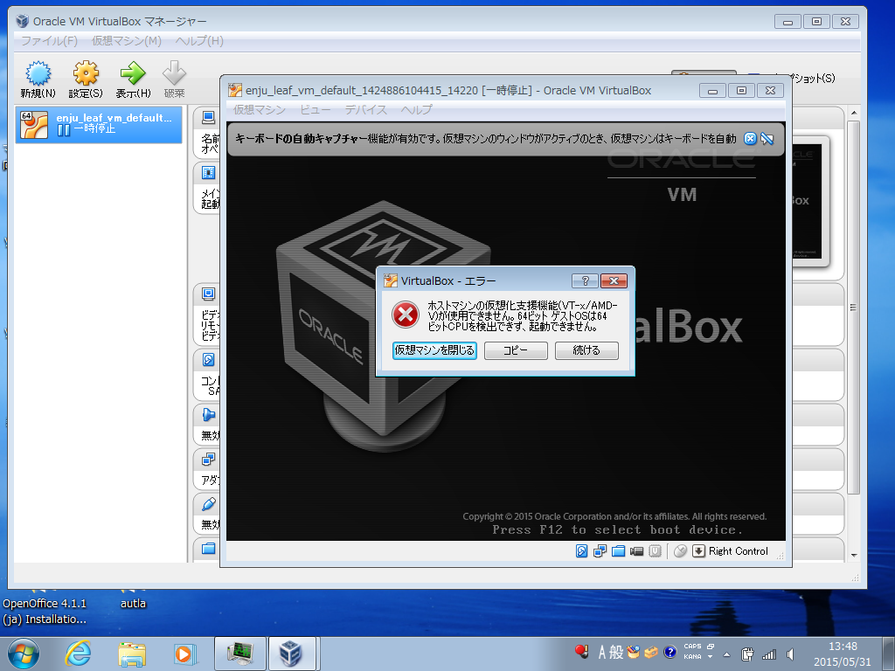

* Contents
{:toc}
{::comment} FAQ.md {:/comment}

第11章 トラブルシューティング {#section11}
===========================================

## Q. Dockerでプロキシ環境でも使用できる方法をおしえてください。

#### 1. https へのアクセスは可能である必要があります。

#### 2. ~/enju/.envに以下の2行を追加してください。プロキシのホスト名とポートは適宜変更してください。EnjuがNDLサーチ検索など外部のサービスにアクセスするための設定です。

	export http_proxy=http://proxy.example.com:8080
	export https_proxy=$http_proxy

#### 3. ~/.profileに以下の2行を追加してください。プロキシのホスト名とポートは適宜変更してください。rubygems.orgからgemを取得するための設定です。

	export http_proxy=http://proxy.example.com:8080
	export https_proxy=$http_proxy

#### 4. ~/.gitconfig（無ければこのファイルを作成する） に以下を記入してください。プロキシのホスト名とポートは適宜変更してください。gitでプロキシを使用するための設定です。

	[https]
		proxy = http://proxy.example.com:8080
	[http]
		proxy = http://proxy.example.com:8080
	[url "https://"]
		insteadOf = git://

#### 5. ログアウトしてログインしなおしてください

#### 6. Enjuを再起動してください（--> 詳細は[8-3節](enju_install_vm_8.html#section8-3)を参照）

【Memo】バージョン1.1.0rc15現在、認証機能付きプロキシ設定には対応していません。

{::comment}

## Q. VT機能が無効になっているというメッセージが表示されます。

VirtualBoxを起動した際，64bit CPUを使用していても，以下のような警告画面が表示されて起動できないことがあります。これは，Virtualization Technologyという機能が無効になっている場合などに表示されます。

各コンピュータのマニュアルを参照してBIOSのセットアップでVirtualization Technology機能を有効にしてから再起動してください。

## Q. 大きなファイルをTSVインポートしようとすると"413 Request Entity Too Large　nginx/1.4.6 (Ubuntu)"といったエラーメッセージが表示されてできません。

配布しているコンテナでは、
TSVインポートに使えるファイルサイズは、標準設定では、1MBになっています。
これは、コンテナで使っているWebサーバー：nginxの設定による制約です。
そのため、1MBを越えるファイルサイズの場合は、質問に挙げられたような状況になります。

たとえば20MBなど少し大きめのサイズまでできるようにするには、次のようにします。

#### 1. 設定ファイルのバックアップをとる（念のため）

	$ sudo cp /etc/nginx/nginx.conf /etc/nginx/nginx.conf.old

#### 2. 設定ファイルを編集する。

	$ sudo vi /etc/nginx/nginx.conf

として編集する。

	http {
		...
	}

の部分に、一行足して

	http {
		...
		client_max_body_size 20M;
	}

とします。

#### 3. Webサーバーを再起動する。

	$ sudo /etc/init.d/nginx restart

#### 4. OK が表示されるのを確認する。されなければ、 2. の編集を再度行い、3. 以降を実行する。

	　　* Restarting nginx nginx                                                [ OK ]

## Q. 504 Gateway Timeout というエラーメッセージが表示されて画面が表示されません。

設定の誤り等により起動時にエラーが発生している場合、ログファイルを確認する必要があります。
エラーメッセージが出ていないか以下の場所等を確認してください。

[起動時のエラー]

  * /var/log/upstart/enju_leaf-web-1.log
  * /var/log/upstart/enju_leaf-solr-1.log
  * /var/log/upstart/enju_leaf-resque-1.log

[稼働中のログ]

  * enju/log/production.log
  * sunspot-solr-production.log

{:/comment}


