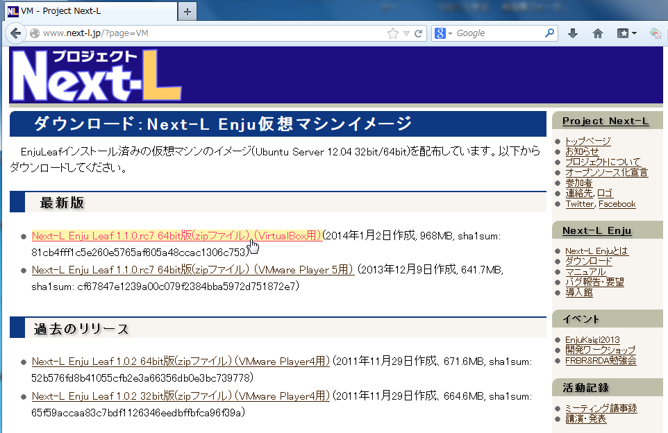
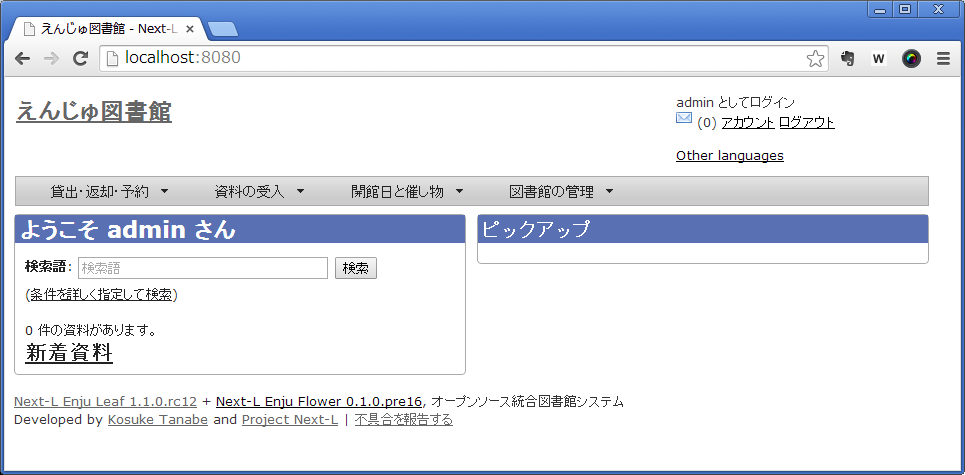

* Contents
{:toc}
{::comment} install.md {:/comment}

4章 Enjuのインストール(スタンドアロンで動作させる)  {#section4}
====================================================

4-1 Enjuコンテナの入手 {#section4-1}
--------------------------------------

Enjuのインストールに必要なパッケージは，すべてネットワーク上で提供されます。

### 4-1-1 Enjuパッケージの提供場所 {#section4-1-1}

Enjuは，以下のURLで最新版が提供されています。インストールする環境に合わせ，必要なパッケージをダウンロードします。

* [https://www.next-l.jp/?page=VM](https://www.next-l.jp/?page=VM)



### 4-1-2 ファイル名 {#section4-1-2}

(TBD)

### 4-1-3 パッケージのダウンロード {#section4-1-3}

(TBD)

4-2 Dockerの起動 {#section4-2}
----------------------------------

Dockerを起動し，Enjuコンテナを開きます。

#### 1. Dockerを起動します。

#### 2. Enjuコンテナが開きました。


4-3 Enjuコンテナの起動とログイン {#section4-3}
------------------------------------------------

Enjuコンテナを起動します。

#### 1. ［xxxx］(例：vagrant_default_1388...)をクリックして，［起動(T)］をクリックします。

#### 2. プロンプトが表示されていることを確認します。

### 4-4-3 メールサーバーの設定 {#section4-4-3}

再発行したパスワードのメール送信の機能などを使うために必要です。

config/environments/production.rb を以下のように変更します。

```
Rails.application.configure do
  # 中略

  # hostオプションはEnjuを動作させているホストのホスト名を指定
  config.action_mailer.default_url_options = {host: 'enju.example.jp'}

  # SMTPサーバの設定。不要な設定はコメントアウトできます
  # 設定例は以下も参照してください
  # http://railsguides.jp/action_mailer_basics.html#gmail用のaction-mailer設定
  config.action_mailer.delivery_method = :smtp
  config.action_mailer.smtp_settings = {
    address: 'yoursmtpserver.example.jp',
    port: 25,
    domain: 'example.jp',
    user_name: 'smtpusername',
    password: 'smtppassword',
    authentication: 'plain',
    enable_starttls_auto: true
  }
end
```

4-5 Enjuの起動確認 {#section4-5}
------------------------------------------------

Next-L Enjuが正しく起動したかどうかは，サーバ上だけではわかりにくいので，ネットワークに接続された別のコンピュータから確認します。別のコンピュータといっても，物理的に別のコンピュータを使うのではなく，Next-L Enjuが動作している同じコンピュータのWebブラウザを用いて確認を行います。すなわち，ゲスト(今回の場合はDocker中のEnjuコンテナ)とホスト(ここではDockerが動作しているWindows)とは論理的には別のコンピュータと見なすことができますので，Windows上のWebブラウザを使って確認すれば良いことになります。

#### 1. ホストOS(Windows)に制御を戻します。右「Ctrl」キーを押します。ウィンドウ右下の矢印が（グレーの矢印）のようにグレー色になります。

#### 2. ブラウザからアクセスします。Windows上でWebブラウザを立ち上げます。

#### 3. アドレス欄に```http://localhost:3000```と入力してください（ブラウザによっては ```localhost:3000``` でも可）。



#### 4. "We're sorry ..." といったメッセージがでる場合、solrの起動が完了していない場合があります。数分待ってからもう一度アクセスしてみてください。

これで，Enjuのサーバに対してアクセスすることが可能になりました。

4-6 Enjuサーバの停止と再起動 {#section4-6}
------------------------------------------

### 4-6-1 Enju コンテナのシャットダウン {#section4-6-1}

Enjuコンテナを終了(シャットダウン)させる場合には，正しい手順でのシャットダウンを行う必要があり，Dockerをいきなり終了させたり，PCの電源ボタンを押すなどして強制終了させると，使用中のデータベースファイルが壊れて，再起動できなくなるなどの問題が発生する可能性があります。

#### 1. 以下のコマンドを入力します。

	docker compose down

Enjuコンテナをシャットダウンするタイミングは，図書館の運用方針で決定することができます。起動したら基本的にはずっと動作させ続けていても問題ありません。毎日Enjuコンテナをシャットダウンする，必要な時だけ稼働させるなど，ポリシーに応じた運用をすることができます。

### 4-6-2 Enju コンテナの再起動 {#section4-6-2}

#### 1. Dockerが終了していた場合，再度Dockerを起動してください。

(TBD)

#### 2. 「4-3 Enjuコンテナの起動とログイン」の1~4を実行してEnjuコンテナを起動してください。

これで，再度Enjuが利用できるようになりました。



