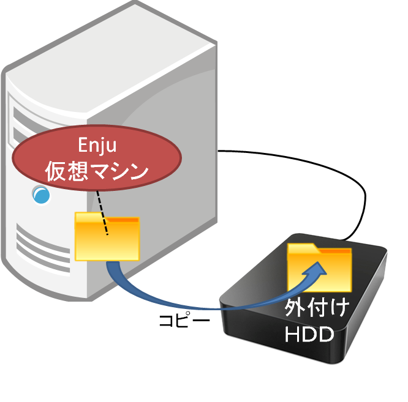
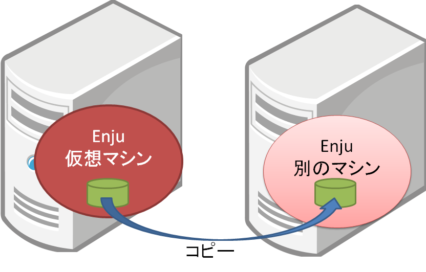

* Contents
{:toc}

第9章 データのバックアップとリストア {#section9}
================================================

{:toc}

以下の方法があります。

* コンテナのファイルのバックアップをとる・使う
* コンテナ上のデータのみのバックアップ・リストアする

9-2 コンテナごとバックアップをとる・使う {#section9-2}
--------------------------------------------------------

今使っているコンテナを外付けのHDDにコピーして、
マシンのハードウェア障害に備えたり、
別のマシンにコンテナごと移築したいときの方法です。

### 9-2-1 コンテナごとバックアップをとる {#section9-2-1}

#### 1. 現在、使っているコンテナをシャットダウンします。

[「4-6-1 Enju コンテナのシャットダウン」](enju_install_vm_4.html#section4-6-1)を参照してください。

#### 2. Docker の現在使っているコンテナをクリックします。

(TBD)

#### 3. 「コンテナ」メニューの「エクスプローラーに表示」をクリックします。

(TBD)

### 9-2-2 バックアップをとったデータを使う {#section9-2-2}

(TBD)

9-3 データのみのバックアップ {#section9-2}
------------------------------------------

別のコンピュータにEnjuを移したいとき、例えば、Amazon EC2に移設したい、
Macに移設したい、CentOS に移設したいといった場合の方法です。
こちらについては、[他のサーバへの移行（https://github.com/next-l/enju_leaf/wiki/Backup）](https://github.com/next-l/enju_leaf/wiki/Backup)を参照してください。

{::comment}別ファイル名候補：backup.md{:/comment}


